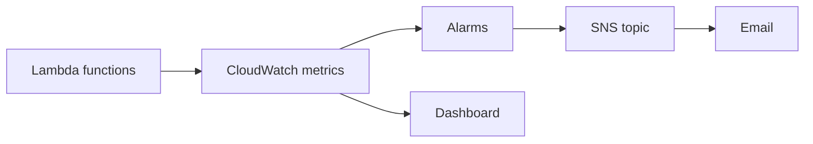

# Serverless Observability with Terraform and CloudWatch

CloudWatch dashboards, alarms, and SNS email alerts for AWS Lambda workloads, all defined in Terraform. It monitors three serverless projects: a daily job alert, a weekly learning digest, and an S3-triggered document pipeline.

## What it creates

| Resource | Purpose |
|----------|---------|
| SNS topic and email subscription | Delivers alarm notifications to an inbox |
| Errors alarm (one per function) | Fires when a function reports any error |
| "Not running" alarm, daily | Fires if a daily scheduled function has no invocations in 24 hours |
| "Not running" alarm, weekly | Fires if a weekly scheduled function has no invocations for 7 days |
| CloudWatch dashboard | Invocations, errors, throttles, and duration for each function |

The "not running" alarms matter most. A schedule that silently stops produces no errors at all, so an errors alarm alone would never notice.

## How it works



## Repository layout

| Path | Purpose |
|------|---------|
| `infra/main.tf` | All resources and variables |
| `infra/terraform.tfvars` | Your alert email address (git-ignored, never committed) |

State is stored remotely in S3 with native locking.

## Setup

1. Create `infra/terraform.tfvars` containing `alert_email = "you@example.com"`.
2. Change the function names in the `lambda_functions`, `scheduled_functions`, and `weekly_functions` variables to your own.
3. From `infra/`, run `terraform init`, `terraform plan`, then `terraform apply`.
4. Confirm the subscription from the email AWS sends you. Alarms cannot reach you until you do.

## Testing the notification path

Force an alarm into the alarm state without touching the function:

```
aws cloudwatch set-alarm-state --region us-east-1 \
  --alarm-name <function-name>-errors \
  --state-value ALARM --state-reason "Testing the notification path"
```

An email arrives within a minute, and the alarm returns to `OK` at its next evaluation.

## Lessons learned

- **An empty email variable fails late.** The SNS subscription was rejected with "Invalid parameter: Endpoint" after the other resources had already been created. Terraform kept what it had made, and fixing the variable and re-applying created only the missing resource.
- **Different schedules need different alarm windows.** A daily function and a weekly function can't share one "not running" alarm.
- **Event-driven functions have no schedule to miss,** so they get an errors alarm but no "not running" alarm.

## Next steps

- Add a log metric filter that counts specific log lines, such as "No new jobs".
- Deploy changes through a plan and approve-apply GitHub Actions workflow.
- Add duration alarms for slow runs.
